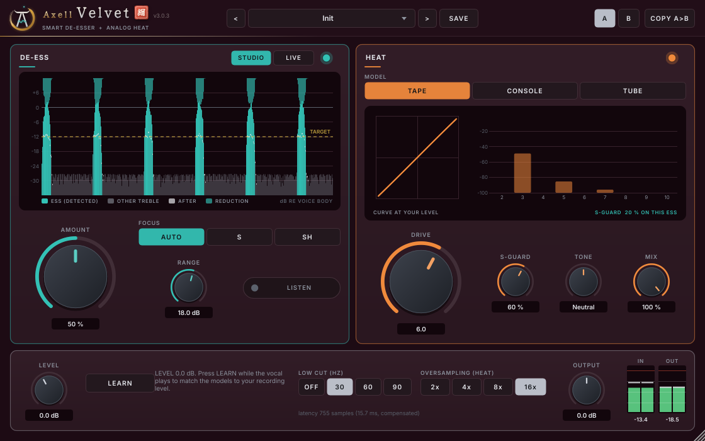

# Axell Velvet (VST3, Linux)

The vocal plugin of the Axell suite: a de-esser that recognises sibilants instead of listening for loud treble, and
three analog saturation models (tape, console, tube) to give a voice its signature warmth. The two are linked:
S-GUARD keeps the warmth off the esses, so the saturation never makes them harsh again.

> **Part of Axell's Dojo** - the Axell Signature suite for rap vocals, beats and masters on Linux:
> [Penta EQ](https://github.com/zmardanian/axell-penta-eq) · [Duo Compressor](https://github.com/zmardanian/axell-duo-compressor) ·
> [Gate](https://github.com/zmardanian/axell-gate) · [De-Reverb](https://github.com/zmardanian/axell-dereverb) ·
> [Velvet](https://github.com/zmardanian/axell-velvet) · [Master](https://github.com/zmardanian/axell-master) ·
> [Space](https://github.com/zmardanian/axell-space) · [Forbidden Seal](https://github.com/zmardanian/axell-forbidden-seal), installed,
> updated and tuned to your voice by the [Axell Signature Dojo](https://github.com/zmardanian/axell-signature-dojo).
> Since 3.0 the plugins share one core library (`external/axell-core`): a breakthrough in one plugin becomes a
> feature of the next.

## What's new in 3.0

- **3.0.0 - LIVE de-esser, zero latency**, for recording while you hear yourself through the plugin: its own causal
  detector network and the same cut made minimum phase every 2 ms. With HEAT off Velvet adds no latency at all.
- **3.0.0 - the detector trained on 111 voices** instead of three (CMU ARCTIC + 108 VCTK voices, forced-aligned
  labels): on 12 accents it never heard F1 0.82 (1.0: 0.72); on the artist's own takes half as many harsh esses left
  uncut. Against a third-party sibilance-aware de-esser on 15 unseen voices: 30-80x less change on vowels at equal
  harsh-ess removal.
- **3.0.1 - Axell's Dojo look**: the family emblem, a brush-written title with Velvet's seal (絹, "silk"), a wine
  ground. The sound is identical to 3.0.0.
- **Shared with the suite**: Velvet's detector networks and its zero-latency minimum-phase method live in the shared
  core - Axell Gate 3.0's second network, Penta EQ 3.0's Ess source and De-Reverb 3.0's LIVE mode are built on them.

## What it does

**DE-ESS** is a one-knob de-esser. **AMOUNT** sets how far the esses come down. There is no threshold: the same
setting works on a quiet verse and a loud chorus, at any recording level.
- **Detection:** a small neural network trained on 111 voices of labelled speech (many accents) recognises s, z, sh,
  zh, ch and j by their sound (noisiness, spectral shape, how long the noise lasts). It is not a treble meter.
- **Cut:** only the frequencies where each ess is harsh are lowered. An "s" whistling at 8.7 kHz is cut at 8.7 kHz,
  a "sh" at 3.3 kHz at 3.3 kHz. Vowels, "t" bursts and hi-hat bleed are left alone.
- **STUDIO / LIVE:**
  - STUDIO (default, for mixing): ten linear-phase bands with 4 ms look-ahead; 14 ms latency, compensated by the host.
  - LIVE (for recording while you hear yourself through the plugin): zero latency. A causal detector with its own
    network, and the same cut made minimum phase. With HEAT off the plugin adds no latency at all; with HEAT on, the
    oversampler's 1.7 ms (0.4 ms at 96 kHz).
  - In both, with nothing to cut the output is the input bit for bit.
- **More controls:**
  - RANGE: the most any band may be cut.
  - FOCUS: Auto / S / SH.
  - LISTEN: hear only what is removed.
  - The display shows every ess, the target and the reduction live.

**HEAT** offers three models, run at 16x oversampling:
- **TAPE:** magnetic tape (Jiles-Atherton hysteresis with record and playback emphasis). Treble and esses saturate
  first, as on tape; the low end gets a playback head bump. Smooth, glued, odd harmonics.
- **CONSOLE:** an input transformer (low, loud notes saturate first) into a class-A transistor stage. Punch,
  weight, presence; 2nd and 3rd harmonics.
- **TUBE:** a triode stage (Koren's tube equations on a real load line) with grid conduction and bias shift. Sweet,
  mostly 2nd harmonic, blooms on loud notes.

Each model has these controls:
- **DRIVE (0-10):** calibrated so every model adds the same amount of harmonics at the same setting (-55 dB at 0,
  -35 dB at 5, -15 dB at 10). The level is matched automatically, so turning it up adds character, not volume.
- **S-GUARD:** how much the esses are kept out of the heat.
- **TONE:** dark ↔ bright.
- **MIX:** parallel saturation.
- The display shows the model's curve at your vocal's current level and the harmonics it adds.

**GLOBAL**:
- **LEVEL + LEARN:** play the vocal and press LEARN. LEVEL is set so the models meet your recording at their nominal
  level, so DRIVE means the same on every recording. LEVEL never changes the output volume.
- **LOW CUT** (Off / 30 / 60 / 90 Hz, 24 dB/oct): removes rumble before the models, which would otherwise distort
  the voice with it. The default 30 Hz takes only what you can't hear.
- **OUTPUT**, oversampling 2x-16x, A/B, user presets.

There are 28 factory presets in six groups:
- Essentials
- Rap & Hip-Hop
- Singing
- Special
- Tracking (Live): the LIVE de-esser for recording, alone or with light tape.
- MY VOICE: six presets made on Axell's own voice and recording chain (a large-diaphragm condenser into an
  interface preamp with a FET compressor), one of them for tracking. They also set LEVEL and a 90 Hz low cut for
  that chain.

## Measured quality

| | |
|---|---|
| Nothing to do (de-ess 0 %, heat off, low cut off) | STUDIO: output = input delayed by the reported latency, bit for bit; LIVE: output = input, no delay (44.1 / 48 / 96 / 192 kHz, any block size) |
| Silence in, full drive | exactly silence out |
| De-esser vs a third-party sibilance-aware de-esser (Sibalance, 20 ms look-ahead), 15 voices it never trained on, at equal harsh-ess removal | 30-80x less change on vowels, 7-11x less on t/k/p, 5-12x less taken from already-soft esses; LIVE (zero latency) still 20-40x less on vowels |
| De-esser vs the classic designs, same test | 25-40x less change on vowels, 4-8x less on t/k/p, 3-8x less taken from already-soft esses |
| The artist's own 12 takes (rap, English and Romanian; no model saw them) | harsh esses left uncut at AMOUNT 50: 1.0 16, 3.0 8, 3.0 LIVE 6; vowels changed by 0.006 dB on average |
| LIVE vs STUDIO | the same cut shape (minimum phase vs linear phase); at equal harshness 2-3x STUDIO's (tiny) vowel change: 0.008 vs 0.003 dB |
| Detector | 111 training voices; held out: F1 0.82 (1.0: 0.72) on 12 accents it never heard; rate independent (44.1-192 kHz) and level independent (-44 vs -14 dBFS: reduction within 0.5 dB) |
| HEAT aliasing, 7 kHz at -6 dBFS, full drive | ≤ -95 dBc at 16x (tape -120 dBc) |
| HEAT aliasing at equal saturation (3 % THD) vs certified UAD plugins | Velvet tape -108 / console -129 / tube -113 dBc; UADx Oxide -96, 610-B -89, Century -79, 610-A -70 dBc |
| Auto gain | small-signal gain 0 ± 0.25 dB in every model; every preset keeps the vocal's level within 0.5 dB |
| Latency | STUDIO 755 samples at 48 kHz (15.7 ms; the de-esser's look-ahead); LIVE 83 (1.7 ms, the HEAT oversampler) or 0 with HEAT off; reported exactly, changes only after the host was told |
| CPU (48 kHz stereo, one core, 16x) | tape ≈ 8-10 %, console ≈ 6 %, tube ≈ 5 % (8x: 8 / 4 / 3.4 %) |
| Real-time safety | no allocation, lock or I/O in the audio path (allocation counter in the test suite) |

All of these come from:
- the automated suites: `tests/`, 467 DSP checks at 44.1 / 48 / 96 / 192 kHz (STUDIO and LIVE) plus 58 plugin checks;
- an independent black-box audit through a VST3 host (`tests/independent/velvet_audit.py`, 54 checks, signals and
  analysis from textbook definitions);
- AddressSanitizer + UBSan;
- pluginval at strictness 10;
- Steinberg's VST3 validator (47/47).

The benchmarks are in `research/` (`bench3.py`, `realtakes3.py`, `bench_cpp.py`, `uad_bench.py`). The reasoning behind every design choice, with
what was tried and rejected, is in [docs/DECISIONS.md](docs/DECISIONS.md).

## Engineering progress

| Version | Date | Engineering | Measured |
|---|---|---|---|
| **1.0.0** | 2026-10-15 | A neural sibilance detector (19 inputs, 32 hidden; trained on the shipping C++ features of 3 ARCTIC voices) driving a water-filling cut in ten complementary linear-phase bands; HEAT: tape (Jiles-Atherton hysteresis), console, tube models with matched harmonics; S-GUARD; LEARN; 25 presets | Bit-exact when there is nothing to cut; aliasing <= -95 dBc at full drive (16x); held-out voices: F1 0.72 |
| research | 2026-10-25 | A Romanian detector retrain and a de-plosive studied (DECISIONS V17, V18) | Neither beat what shipped (LOW CUT 90 handles pops on real takes): not adopted |
| **3.0.0** | 2026-10-25 | Detector retrained on 111 voices (MFA labels); LIVE: causal detector + the cut made minimum phase per hop (real cepstrum), zero latency; 192 kHz verified; benchmark vs a third-party de-esser and the classic designs | Unseen accents F1 0.82, 97 % of sibilant energy caught; vowels changed 30-80x less than Sibalance at equal harsh-ess removal (LIVE 20-40x); the artist's takes: harsh esses left 16 -> 8 (LIVE 6); 467 DSP + 58 plugin checks, audit 54/54 |
| **3.0.1** | 2026-10-26 | Axell's Dojo look (shared core brand title, per-plugin ground) | DSP identical; the same suites, ASan clean, pluginval L10, validator 47/47 |
| **3.0.2** | 2026-10-26 | Faster pitch analysis in the shared core (the sibilance detector's pitch analysis): eight lags in registers, same summation order | Output byte-identical to 3.0.1; CPU 8.94 -> 8.72 % of one core (-2.4 %) |
| **3.0.3** | 2026-10-27 | The version on the interface (small and quiet after the title) | Audio byte-identical to 3.0.2 |

Every design decision with its measurement: [docs/DECISIONS.md](docs/DECISIONS.md); all changes: [CHANGELOG.md](CHANGELOG.md).

## Install (Linux)

Download `AxellVelvet-3.0.3-linux-x86_64.tar.gz` from the
[latest release](https://github.com/zmardanian/axell-velvet/releases/latest) (optional: `sha256sum -c SHA256SUMS.txt`), then:

    tar xzf AxellVelvet-3.0.3-linux-x86_64.tar.gz
    cd AxellVelvet-3.0.3-linux-x86_64
    ./install.sh

The installer copies `Axell Velvet.vst3` to `~/.vst3`. Then in REAPER: Options > Preferences > Plug-ins > VST >
Re-scan. Put it on the vocal track, after pitch correction and before the compressor (or after it: the de-esser
does not depend on level). Or let the [Axell Signature Dojo](https://github.com/zmardanian/axell-signature-dojo)
install and update it.

## Build (Bazzite / any Linux, inside a distrobox)

    bash scripts/setup-toolbox.sh      # creates the juce-build distrobox (Ubuntu 24.04) once
    bash scripts/build.sh
    bash scripts/test.sh               # DSP + plugin suites (--quick, --asan)
    bash scripts/pluginval.sh
    bash scripts/install.sh

- JUCE 8.0.15 is fetched by CMake.
- The DSP lives in JUCE-free headers: `Source/Engine.h`, `Sibilance.h`, `Heat.h` and the shared Axell core in
  `external/axell-core` (or `../axell-core`). It is tested with plain g++.
- The detector's weights (`Source/DetectorModel.h`) are generated by `research/train_cpp.py` from the features of the
  shipping C++ code (`tools/VelvetFeatures.cpp`).

## Contact

Axell Yobag - axellpetre@protonmail.com (questions, bug reports, feedback). Issues on GitHub are welcome too.

Licence: GNU AGPLv3 (`LICENSE`); third-party components and the CMU ARCTIC and VCTK notices (training data of the
detectors) in `THIRD_PARTY_NOTICES.md`. No code, data or graphics of any commercial product are used.
